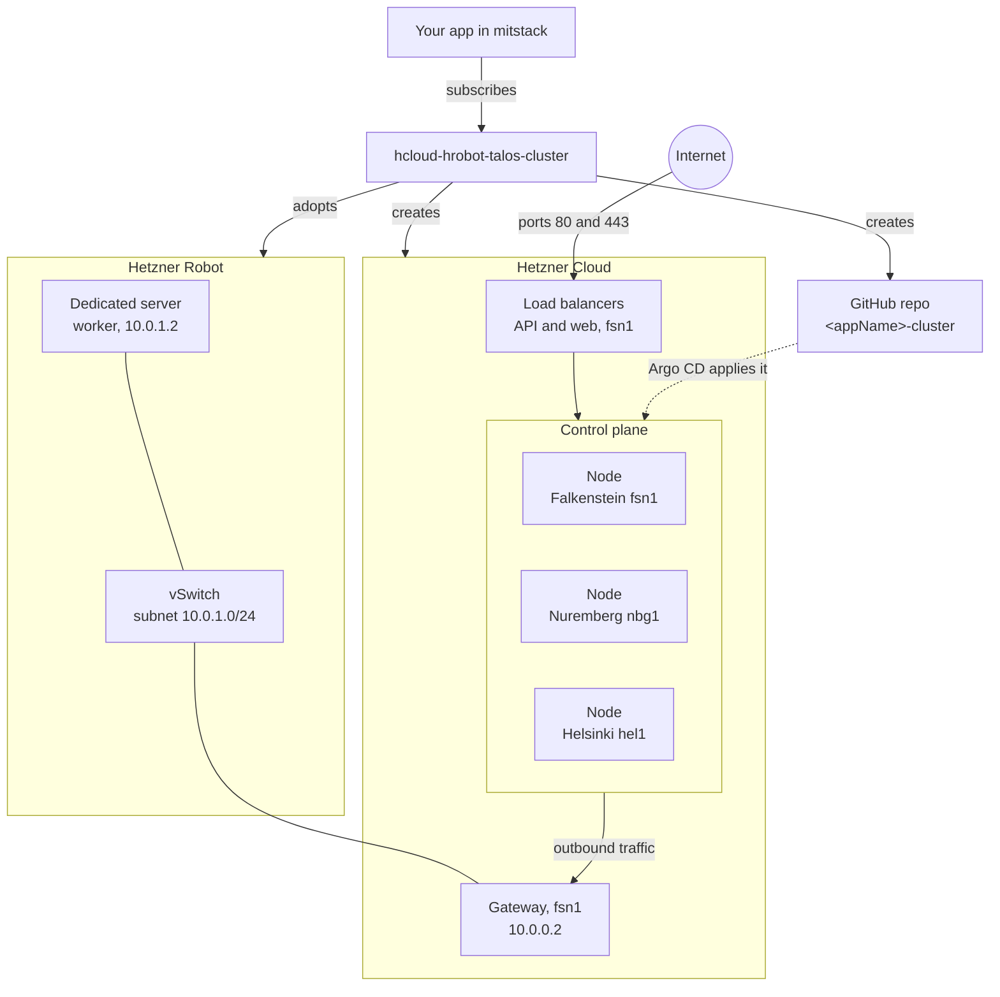
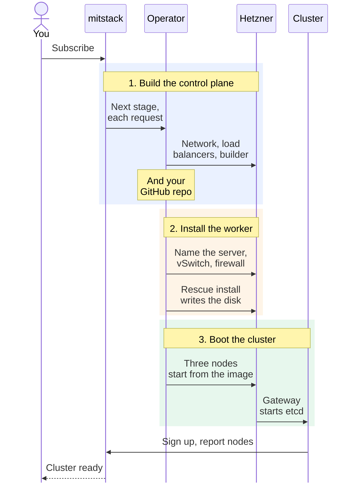

# hcloud-hrobot-talos-cluster

Your app's own Kubernetes cluster, with its control plane on Hetzner Cloud and its worker on a Hetzner dedicated server.

The cluster runs Talos Linux, an operating system made only for Kubernetes.
Its control plane, the part that runs Kubernetes itself, has one Cloud node each
in Falkenstein, Nuremberg and Helsinki, and your apps run on a dedicated server.
Argo CD, a tool inside the cluster, applies what you commit to a GitHub repo the
block makes. mitstack is a platform that runs ready-made services, called
blocks, for your apps.
[The glossary](https://github.com/mitstack-eu/mitstack-workspace/blob/main/docs/glossary.md) defines its other words.

The block builds the Cloud control plane that
[hcloud-talos-cluster](https://github.com/mitstack-eu/hcloud-talos-cluster)
builds: three Hetzner Cloud servers and a gateway server. It then installs one
Hetzner Robot server your account rents as the cluster's worker, where your
apps run. Robot servers are dedicated machines rented by the month, and Cloud
servers are virtual ones. The worker joins the Cloud network over a vSwitch,
Hetzner's private link between a dedicated server and a Cloud network.
[ADR 0103](https://github.com/mitstack-eu/mitstack/blob/main/docs/adr/0103-mitstack-offers-five-hetzner-capacity-blocks-and-keeps-the-k3s-block.md)
decides that mitstack offers this mix as one of its five Hetzner blocks. The
control plane's code lives in the `controlplane` package of
[talos-cluster-kit](https://github.com/mitstack-eu/talos-cluster-kit/blob/main/README.md#how-a-block-drives-the-cloud-control-plane).



## At a glance

| You give it | You get |
|---|---|
| `appName`, your app's name | A Kubernetes cluster for your app alone, with three control-plane nodes and one worker |
| `robotServerNumber`, the Robot number of a dedicated server your account rents | `privateEndpoint`, the cluster's private API address |
| `serverType`, the Cloud node size, `cx33` by default | `publicIpByLocation`, the web traffic IP, under `fsn1` |
| A Hetzner connection with `api_token`, and the Robot webservice login `robot_user` and `robot_password` | `clusterRepoUrl`, the private `<appName>-cluster` repo |
| A GitHub connection, for its token and owner | The dedicated server, named for the subscription and set up as the worker |

The block provides the type `hetzner.kubernetes-cluster` and needs no other
block. The operator's host must also set `MITSTACK_EGRESS_IPV4` to its public
IPv4 address. [Params, connections and outputs](docs/reference.md) has every table.

## Use it

1. In your Hetzner Cloud project, make a read and write API token under Security, API tokens.
   In Robot, make the webservice login. Connect the token, the login and GitHub on the
   mitstack console's [Capabilities page](https://api.mitstack.dev/capabilities).
2. Find the number of the dedicated server your account rents for the worker. It must sit
   in `fsn1`, `nbg1` or `hel1`.
3. Open this block on the console's [Blocks page](https://api.mitstack.dev/blocks), choose
   **Add to an app**, pick your app, and fill in `appName` and `robotServerNumber`.
4. Once the console shows the subscription ready, in up to 75 minutes, commit
   your Kubernetes manifests to the repo's `cluster/` folder.

## How it works

A cluster takes up to 75 minutes to build, but mitstack waits only two minutes
for each answer. So the operator, the program in this repository, does one
small stage each time mitstack asks, and mitstack keeps asking until it is done.

The control plane builds as in the kit: a short-lived builder server makes the
disk image every Cloud node starts from, and the gateway, the only Cloud server
with a public address, starts etcd, the cluster's database. In the call that
creates the gateway and the builder, the operator also starts the worker's
install in the background of its own process. That call is the only moment the
cluster's keys exist outside the image. The install names the dedicated server,
couples it to a vSwitch, builds the worker's disk image on a short-lived Cloud
server and writes it from Hetzner's rescue system. App pods run on the worker
alone, and the control-plane nodes take none.



The cluster is ready once the control plane stands, the worker is written, and
the newest node report since the last Cloud node's creation names every Cloud
node and the worker, all Ready.

When you unsubscribe, the operator stops the install, deletes every Cloud
resource, takes the server off the vSwitch and cancels the vSwitch. It releases
the server by clearing its name and opening its firewall, and never cancels it.
It then deletes the repo when it carries the two GitHub topics the block set on it.

## Limits

- The Robot webservice login reaches every server, vSwitch, firewall and key of
  the Robot account, not only the adopted server. The block uses the one
  login the connection holds, and acts only on the server whose number the
  subscription names, and on the vSwitch named for the subscription.
- Robot allows `GET /server/{number}` 200 times an hour, and the vSwitch and
  firewall reads 500 times. Past a limit it answers `403 RATE_LIMIT_EXCEEDED`,
  and after three failed logins it blocks the calling address for ten minutes.
  The operator answers a repeat Robot read from its last answer for one minute,
  about 60 reads an hour each. While Robot still refuses, the build waits and
  changes nothing in Robot, as
  [Robot's request limits](docs/build-progress-and-failures.md#robots-request-limits)
  explains.
- A cluster has one worker in this release.
- A restart of the operator during the worker's install loses the cluster's
  keys, and the next subscribe refuses with `worker-install-lost`. You then
  unsubscribe and subscribe again.
- Two points are not yet proven live: the Cilium MTU over the vSwitch, and
  whether Hetzner deletes a network that still has a vSwitch coupled.

## What's inside

```text
│   # Every block starts with these
├── manifest.yaml            what the block builds, provides and answers
├── main.go                  starts the web service: /hook, /logs, /healthz
├── resource.go              reads the params, the logins and the host setting, and takes each subscribe stage
├── Dockerfile               builds the operator's container image
├── go.mod, go.sum           the Go module and its checksums
├── secrets_leak_test.go     proves no token reaches an answer or a log
├── teardown_test.go         proves unsubscribe deletes everything
├── .github/workflows/ci.yml tests the block and publishes its image
│   # This block adds these
├── LICENSE                  Business Source License 1.1
├── docs/                    the detail behind this page
├── identity.go              names the plane and the Robot server and vSwitch
├── worker.go                the worker's install, its progress, refusals and repairs
├── state.go                 reports the resources the subscription created
├── repository.go            creates, reads and deletes the cluster repo
├── observe.go               reads each resource and sets the outputs
├── nodereports.go           reads the cluster's node reports
├── hosting.go               the deploy keys and recovery outputs of the cluster that hosts mitstack
├── teardown.go              runs the unsubscribe
├── robotworker/             writes a Robot server's Talos disk from its rescue system
├── *_test.go                the rest of the tests, listed in docs/
└── testdata/                the platform's type snapshot
```

## Go deeper

- [Params, connections and outputs](docs/reference.md): every input and output, and when each appears.
- [How a subscribe runs](docs/how-a-subscribe-runs.md): what it builds, each stage, and unsubscribe.
- [Build progress and failures](docs/build-progress-and-failures.md): what a build reports, and every refusal with what you do about it.
- [Inside the cluster](docs/inside-the-cluster.md): what runs there, the tools image and the logs.
- [Changing the block](docs/changing-the-block.md): running the tests, and what each file holds.
- [A cluster that hosts mitstack](docs/hosting-the-platform.md): the deploy keys and recovery outputs of mitstack's own cluster.
- [How a Robot worker is installed](docs/robot-worker-install.md): each install part, the trial note section it follows, and how the keys reach the disk.
